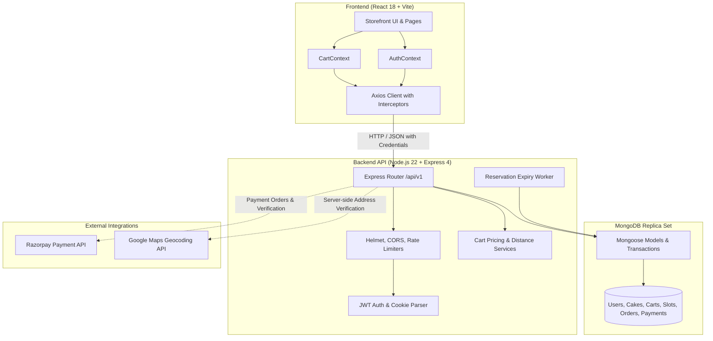
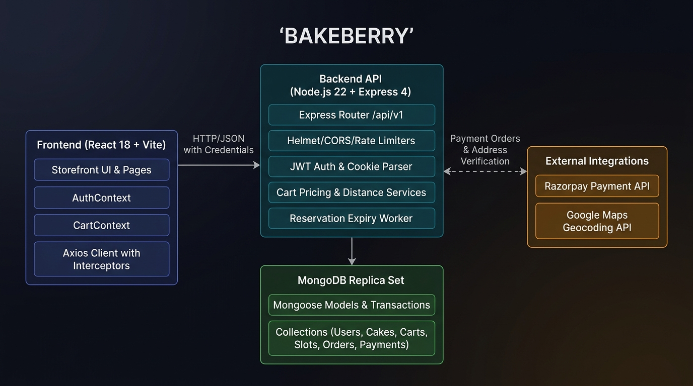
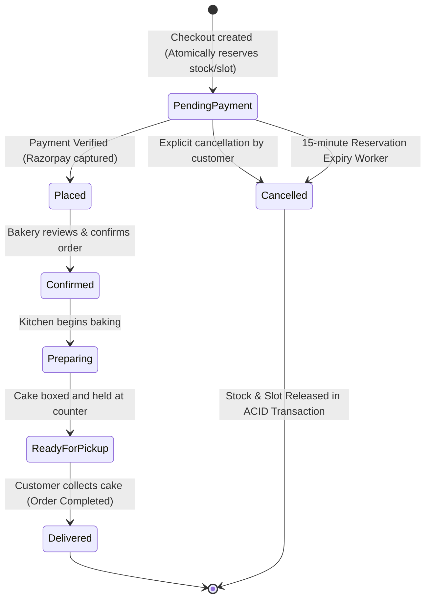
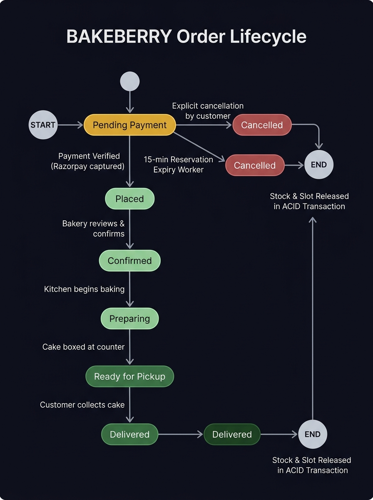

# BAKEBERRY Project Documentation

**Project Name:** BAKEBERRY (Artisanal Bakery & Celebration Cake Storefront)  
**Version:** 1.0.0  
**Last Updated:** October 2026  
**Tech Stack:** React 18, Vite, React Router 6, Node.js 22, Express 4, MongoDB (Mongoose), JWT, Razorpay  

---

## 1. Executive Summary & Purpose

**BAKEBERRY** is a bespoke, single-bakery web application designed for handcrafted cake ordering, instant pickup orders, and advance celebration bookings. 

Unlike multi-vendor marketplaces, BAKEBERRY is strictly dedicated to a single artisanal kitchen. It balances immediate retail demand (cakes ready today in stock) with planned celebration bookings (made-to-order cakes requiring advance notice, custom flavours, and kitchen capacity planning).

### Key Business Goals
1. **Curated Catalogue Experience:** Highlight small-batch celebration cakes with seasonal flavours, dietary options (eggless, fruit, chocolate), and clear stock status.
2. **Dual Fulfillment Modes:**
   - **Ready Today (Pickup / Local Delivery):** Cakes physically in stock in the shop kitchen ready for pickup.
   - **Advance Celebration Booking:** Cakes baked to order with minimum 3-day lead time in shop timezone (`Asia/Kolkata`), slot allocation, and daily kitchen production limits.
3. **Rock-Solid Inventory & Order Integrity:** Server-owned pricing, MongoDB multi-document ACID transactions for stock reservations, idempotent checkout, and automatic release of unpaid reservations.
4. **Seamless User Journey:** Guest browsing with local bag storage, automatic cart migration upon login/signup, instant visual cart counter on the header bag icon, real-time notification toasts, and pickup tracking.

---

## 2. System Architecture



> **📊 System Architecture — Visual Diagram**



### Port Allocation & Endpoints
| Component | Default Host & Port | Environment Variable |
|---|---|---|
| **Frontend Application** | `http://127.0.0.1:5173` | `VITE_API_URL=http://127.0.0.1:4000/api/v1` |
| **Backend REST API** | `http://127.0.0.1:4000` | `PORT=4000` |
| **Database (Dev In-Memory)** | Dynamically allocated by `mongodb-memory-server` | Handled by `src/dev-server.js` |
| **Database (Production)** | MongoDB Atlas replica set URI | `MONGODB_URI` |

---

## 3. Frontend Architecture

The frontend is located at the workspace root and built with **React 18** and **Vite**.

### Directory Structure
```
AI project/
├── index.html              # HTML5 shell with Google Fonts DM Sans & Playfair Display
├── vite.config.js          # Vite config (port 5173, React plugin)
├── styles.css              # Core typography, palette, base component design system
├── src/
│   ├── main.jsx            # Application bootstrap & DOM root
│   ├── App.jsx             # Router definition, route guards, layout shell
│   ├── app.css             # Page-specific styling, responsive layout, micro-animations
│   ├── components/
│   │   ├── SiteHeader.jsx      # Header with navigation, search, profile, and bag icon badge
│   │   ├── SiteFooter.jsx      # Bakery brand footer, hours, links, newsletter
│   │   ├── HomeSections.jsx    # Hero cake showcase, promise strip, booking banner, story
│   │   ├── ProductCard.jsx     # Cake card with stock badges, in-bag count, quick-add
│   │   ├── CakeGrid.jsx        # Category tabs, live search input, responsive grid
│   │   ├── ProtectedRoute.jsx  # Route guard redirecting unauthenticated users to /login
│   │   └── ErrorBoundary.jsx   # Top-level React error boundary
│   ├── contexts/
│   │   ├── AuthContext.jsx     # User session, login, signup, token refresh in memory
│   │   └── CartContext.jsx     # Guest cart, server sync, add/remove, toast & bag bump state
│   ├── pages/
│   │   ├── HomePage.jsx        # Storefront landing page
│   │   ├── CakesPage.jsx       # Full cake collection with filters
│   │   ├── CakeDetailPage.jsx  # Cake size, flavour selection, stock & booking links
│   │   ├── BookingPage.jsx     # Advance calendar booking & slot selection
│   │   ├── CartPage.jsx        # Bag overview, quantity increment/decrement, subtotal
│   │   ├── CheckoutPage.jsx    # Pickup scheduling, order submission, Razorpay handoff
│   │   ├── OrdersPage.jsx      # Customer order history with formatted status badges
│   │   ├── OrderDetailsPage.jsx# Order tracking, pickup confirmation banner, cancellation
│   │   ├── AuthPage.jsx        # Sign in & Account creation tabbed forms
│   │   ├── ProfilePage.jsx     # Account details, addresses, password update
│   │   ├── DeliveryPage.jsx    # Delivery policy & pickup terms
│   │   └── AdminPage.jsx       # Shop inventory, daily orders, capacity overview
│   └── services/
│       ├── apiClient.js        # Axios instance, Bearer injection, auto token refresh
│       ├── authService.js      # Auth API endpoints
│       ├── cakeService.js      # Catalogue & cake details API
│       ├── cartService.js      # Server-side cart operations
│       ├── bookingService.js   # Availability & date validation API
│       ├── orderService.js     # Checkout, order tracking, payment verification
│       └── adminService.js     # Admin dashboard & inventory adjustments
```

### State Management & Lifecycle

#### Authentication Context (`AuthContext.jsx`)
- **Access Token:** Maintained purely in React memory (never saved to `localStorage` or `sessionStorage` to mitigate XSS attacks).
- **Refresh Token:** Stored in an HttpOnly, SameSite cookie by the backend.
- **Silent Refresh:** On app load and upon HTTP 401 response, `apiClient` intercepts the failure, requests `/auth/refresh`, updates the in-memory token, and transparently replays the original request.

#### Cart Context (`CartContext.jsx`)
- **Guest Experience:** Unauthenticated visitors can add items to bag. Their items are stored in `localStorage` under `bakeberry-guest-cart`.
- **Guest-to-User Cart Migration:** As soon as a user signs up or logs in, any guest cart items are automatically migrated to the backend database via `cartService.add()`, and the guest local storage is cleared.
- **Live Badge & Feedback:** Whenever `add()` is called:
  - An interactive pop animation is triggered on the bag icon badge (`bagBumping`).
  - A toast notification appears at the bottom-center confirming `"Product Added to Bag Successfully (X in bag)"`.
  - The badge number on the bag icon updates immediately.

---

## 4. Backend Architecture

The backend is housed in the `cakeora-backend/` directory and built with **Node.js 22** and **Express 4**.

### Directory Structure
```
cakeora-backend/
├── src/
│   ├── server.js           # Production entrypoint (connects to persistent MONGODB_URI)
│   ├── dev-server.js       # Development entrypoint (starts in-memory replica set & demo seed)
│   ├── app.js              # Express app configuration, security middleware, route registration
│   ├── config/
│   │   ├── env.js          # Environment parser & validation
│   │   └── database.js     # Mongoose connection & disconnect lifecycle
│   ├── middleware/
│   │   ├── auth.js         # JWT Bearer token authentication & role verification
│   │   └── errors.js       # Centralized error handler & ApiError class
│   ├── models/
│   │   ├── User.js         # Customer & admin schema, bcrypt password hashing, addresses
│   │   ├── Cake.js         # Cake catalogue, variants, ready stock, reserved counts
│   │   ├── Cart.js         # Server cart schema per user
│   │   ├── BookingSlot.js  # Date & time slot capacity schema
│   │   ├── ProductionCapacity.js # Daily made-to-order kitchen baking capacity
│   │   ├── Order.js        # Order schema, status history, ACID reservation tracking
│   │   ├── Payment.js      # Razorpay payment orders & verification status
│   │   └── AuditLog.js     # Admin inventory & status change audit log
│   ├── routes/
│   │   ├── auth.js         # Signup, login, refresh, logout, profile, addresses
│   │   ├── cakes.js        # Public catalogue search & admin CRUD
│   │   ├── cart.js         # Customer cart management
│   │   ├── bookings.js     # Slot availability & date validation
│   │   ├── orders.js       # Atomic checkout, customer orders, order cancellation
│   │   ├── payments.js     # Razorpay order generation, signature verification, webhooks
│   │   ├── admin.js        # Admin metrics, stock management, booking slot controls
│   │   └── health.js       # Service health check endpoint
│   ├── services/
│   │   ├── demoSeed.js     # Seeds 8 demo cakes and 14 days of booking slots
│   │   └── geocoding.js    # Address resolution for delivery radius checks
│   ├── jobs/
│   │   └── reservations.js # Background interval job releasing expired unpaid reservations
│   └── utils/
│       ├── booking.js      # Calendar date calculations in Asia/Kolkata timezone
│       ├── distance.js     # Haversine distance formula for delivery radius checks
│       └── tokens.js       # JWT signing and verification helpers
```

---

## 5. Database Schema & Data Models

All models are defined with **Mongoose** and enforce strict validation.

### 1. `Cake`
Represents cakes sold by BAKEBERRY.
- `name`: String (required, indexed)
- `description`: String
- `category`: Enum `["Celebration", "Chocolate", "Fruit", "Eggless"]`
- `images`: Array of `{ url: String, alt: String }`
- `active`: Boolean (default `true`)
- `variants`: Array of subdocuments:
  - `name`: e.g., `"0.5 kg"`, `"1 kg"`, `"2 kg"`
  - `weightKg`: Number
  - `price`: Number (INR)
  - `stock`: Number (ready inventory physically present in shop)
  - `reserved`: Number (inventory currently held during checkout / awaiting payment)
  - `preparationDays`: Number (notice needed if made to order)
  - `productionCapacityPerDay`: Number (maximum daily kitchen limit for made-to-order)
  - `flavours`: Array of String
  - `egglessAvailable`: Boolean
  - `instantEligible`: Boolean (can be picked up today if stock > 0)
  - `advanceEligible`: Boolean (can be booked for a future date)

### 2. `Order`
Represents placed customer orders.
- `orderNumber`: Unique alphanumeric identifier (e.g. `CK-M3K9...`)
- `user`: ObjectId referencing `User`
- `idempotencyKey`: Unique string provided in request headers (8–100 chars)
- `items`: Snapshot of purchased cakes:
  - `cake`: ObjectId referencing `Cake`
  - `variant`: ObjectId referencing variant
  - `name`, `variantName`, `quantity`, `unitPrice`
  - `inventoryMode`: `"ready"` or `"production"`
  - `flavour`, `customization`: String
- `fulfillment`: Enum `["pickup", "delivery"]`
- `bookingDate`: ISO date string (`YYYY-MM-DD`)
- `bookingSlot`: Time string (e.g. `"14:00-16:00"`)
- `subtotal`, `deliveryFee`, `total`: Number
- `currency`: String (default `"INR"`)
- `orderStatus`: Enum `["pending_payment", "placed", "confirmed", "preparing", "ready_for_pickup", "out_for_delivery", "delivered", "cancelled", "refund_pending", "refunded"]`
- `paymentStatus`: Enum `["pending", "paid", "failed", "refunded"]`
- `reservationExpiresAt`: Date (created with +15 minutes holding window)
- `statusHistory`: Array of `{ status: String, at: Date, note: String }`

### 3. `BookingSlot`
Represents shop capacity per time window.
- `date`: String (`YYYY-MM-DD`)
- `slot`: String (e.g. `"10:00-12:00"`, `"14:00-16:00"`, `"16:00-18:00"`)
- `capacity`: Number (total orders acceptable in slot, default 8)
- `reserved`: Number (current confirmed + pending reservations)
- `active`: Boolean

---

## 6. Core Business Logic & State Workflows

### Order Lifecycle & State Machine



> **📊 Order Lifecycle — Visual Diagram**



### Transactional Stock Reservation (`orders.js`)
When a customer clicks **"Place pickup order"**:
1. An `Idempotency-Key` header is sent. If the customer taps twice or network retries, the server detects the key and returns the existing order safely without duplicate billing or double reservation.
2. Inside a **MongoDB ACID multi-document transaction**:
   - For ready inventory items, the variant's `reserved` field is incremented only if `stock - reserved >= quantity`.
   - For advance made-to-order items, `ProductionCapacity.reserved` is incremented for that cake/date only if `capacity - reserved >= quantity`.
   - The selected `BookingSlot.reserved` is incremented only if `capacity > reserved`.
   - The `Order` document is inserted with status `pending_payment` and a 15-minute expiration deadline.
3. The customer's cart is cleared.
4. If payment is completed, the payment verifier decrements both `stock` and `reserved` atomically (finalizing inventory).
5. If payment fails, is cancelled, or expires after 15 minutes, `reservations.js` automatically decrements `reserved` and releases the slot for other customers.

### Human-Friendly Status Presentation
To prevent customer confusion, the frontend maps raw database status codes to clear, reassuring customer labels:
| Database `orderStatus` | Frontend Customer Display | Pill Badge Color |
|---|---|---|
| `pending_payment` | **Pending** (Awaiting confirmation) | Warm Amber |
| `placed` | **Placed** | Soft Green |
| `confirmed` | **Confirmed** | Soft Green |
| `preparing` | **Preparing in Kitchen** | Soft Green |
| `ready_for_pickup` | **Ready for Pickup** | Dark Forest Green |
| `cancelled` | **Cancelled** | Muted Red |

| Database `paymentStatus` | Frontend Customer Display | Pill Badge Color |
|---|---|---|
| `pending` | **Pending Payment** (or Awaiting Confirmation) | Warm Amber |
| `paid` | **Paid** | Soft Green |
| `failed` | **Failed** | Muted Red |

---

## 7. Complete API Reference

All routes are prefixed with `/api/v1`.

### Authentication (`/api/v1/auth`)
- `POST /auth/signup` — Body: `{ name, email, phone, password, confirmPassword }`. Returns `{ accessToken, user }` and sets HttpOnly refresh cookie.
- `POST /auth/login` — Body: `{ email, password }`. Returns `{ accessToken, user }` and sets refresh cookie.
- `POST /auth/refresh` — Uses refresh cookie to return a new `{ accessToken }`.
- `POST /auth/logout` — Revokes refresh token and clears cookie.
- `GET /auth/me` — Protected. Returns authenticated user profile and addresses.
- `POST /auth/me/addresses` — Protected. Saves delivery address.
- `POST /auth/change-password` — Protected. Changes password and revokes all other sessions.

### Cakes & Catalogue (`/api/v1/cakes`)
- `GET /cakes` — Public. Query: `?category=Chocolate&search=Berry&page=1&limit=12`. Returns paginated cakes.
- `GET /cakes/:id` — Public. Returns single cake document with active variants and stock.
- `POST /cakes` — Admin only. Creates a new cake with variants.
- `PATCH /cakes/:id` — Admin only. Updates cake attributes or variants.
- `DELETE /cakes/:id` — Admin only. Soft-deactivates cake.

### Cart (`/api/v1/cart`)
- `GET /cart` — Protected. Returns customer's cart with server-calculated subtotal and pricing.
- `POST /cart/items` — Protected. Body: `{ cakeId, variantId, quantity, flavour, customization }`.
- `PATCH /cart/items/:itemId` — Protected. Body: `{ quantity }`.
- `DELETE /cart/items/:itemId` — Protected. Removes item from cart.
- `DELETE /cart` — Protected. Clears cart.

### Bookings & Availability (`/api/v1`)
- `GET /availability?date=YYYY-MM-DD` — Public. Returns time slots and remaining capacity for the given date.
- `POST /bookings/validate` — Public. Body: `{ cakeId, variantId, date, slot }`. Validates that the date satisfies lead times and kitchen capacity.

### Checkout & Orders (`/api/v1`)
- `POST /checkout` — Protected. Header: `Idempotency-Key: <unique-string>`. Body: `{ fulfillment: "pickup", date: "YYYY-MM-DD", slot: "14:00-16:00" }`. Returns `{ order: Order }`.
- `GET /orders` — Protected. Query: `?page=1&limit=20`. Returns user's order history.
- `GET /orders/:id` — Protected. Returns specific order details (with ownership check).
- `POST /orders/:id/cancel` — Protected. Allows user to cancel an unpaid order, releasing inventory immediately.

### Payments (`/api/v1/payments`)
- `POST /payments/create` — Protected. Body: `{ orderId }`. Creates a Razorpay order ID.
- `POST /payments/verify` — Protected. Body: `{ razorpay_order_id, razorpay_payment_id, razorpay_signature }`. Validates HMAC-SHA256 signature and marks order as paid.
- `POST /payments/webhook` — Razorpay webhook handler for asynchronous payment captures.

---

## 8. How to Run Locally

### 1. Prerequisites
- **Node.js:** v20.0.0 or higher (`node -v`)
- **npm:** v10.0.0 or higher (`npm -v`)

### 2. Start the Backend API (with Demo Data)
In terminal 1:
```powershell
cd "d:\Texol New\AI project\cakeora-backend"
npm install
npm run dev:demo
```
- Starts the Express API at **`http://localhost:4000`**.
- Initializes an in-memory MongoDB replica set (no standalone MongoDB install needed).
- Automatically seeds 8 demo cakes and 14 days of booking slots.

### 3. Start the Frontend Storefront
In terminal 2:
```powershell
cd "d:\Texol New\AI project"
npm install
npm run dev
```
- Starts the Vite development server at **`http://127.0.0.1:5173/`**.
- Open `http://127.0.0.1:5173/` in any web browser to browse the storefront.

---

## 9. Testing & Quality Assurance

Both frontend and backend include automated test suites.

### Run Frontend Tests
```powershell
cd "d:\Texol New\AI project"
npm test
```
- Runs `tests/services.test.js` validating authentication calls, catalogue filtering, cart operations, booking validations, and checkout idempotency headers.

### Run Backend Tests
```powershell
cd "d:\Texol New\AI project\cakeora-backend"
npm test
```
- Executes 13 integration test suites:
  - Calendar date cutoff and minimum 3-day validation in `Asia/Kolkata`.
  - Coordinate and distance calculations.
  - Health check endpoint without database dependency.
  - Consistent 404 error formatting.
  - User signup, cart pricing, atomic transactional checkout, and idempotent retry.
  - Ownership protection (customer cannot view another user's orders).
  - Stock adjustment guards preventing reduction below reserved quantities.
  - Unpaid order cancellation and reservation release.

### Production Build Validation
```powershell
cd "d:\Texol New\AI project"
npm run build
```
- Transforms and bundles all React components, producing production artifacts in `dist/`.

---

## 10. Production Deployment & Security Checklist

Before deploying BAKEBERRY to production, complete the following operational requirements:

### 1. Environment Configurations
| Variable | Purpose | Recommended Production Setting |
|---|---|---|
| `NODE_ENV` | Environment mode | `production` |
| `PORT` | API listen port | `4000` (or host provided) |
| `MONGODB_URI` | Persistent database | MongoDB Atlas Replica Set URI |
| `JWT_ACCESS_SECRET` | Access token signature | 32+ cryptographically random characters |
| `JWT_REFRESH_SECRET` | Refresh token signature | Distinct 32+ characters |
| `COOKIE_SECURE` | HTTPS cookie flag | `true` |
| `COOKIE_SAME_SITE` | Cookie policy | `lax` (or `none` if cross-domain) |
| `CORS_ORIGINS` | Allowed frontend domains | `https://bakeberry.example.com` |
| `FRONTEND_URL` | Frontend origin | `https://bakeberry.example.com` |
| `RAZORPAY_KEY_ID` | Payment public key | Live Razorpay Key ID |
| `RAZORPAY_KEY_SECRET` | Payment private key | Live Razorpay Secret |
| `RAZORPAY_WEBHOOK_SECRET` | Webhook verification | Live Razorpay Webhook Secret |
| `GEOCODING_API_KEY` | Google Maps Geocoding | Google Cloud API Key with Geocoding enabled |

### 2. Hosting Recommendations
- **Frontend:** Deploy Vite build to **Vercel** or **Cloudflare Pages** for fast edge distribution.
- **Backend:** Deploy Express service to a persistent Node host like **Render**, **Railway**, or **AWS ECS/App Runner** (ensuring background timer jobs like `reservations.js` stay alive).
- **Database:** **MongoDB Atlas** M10+ replica set with automated backups and transaction support.
